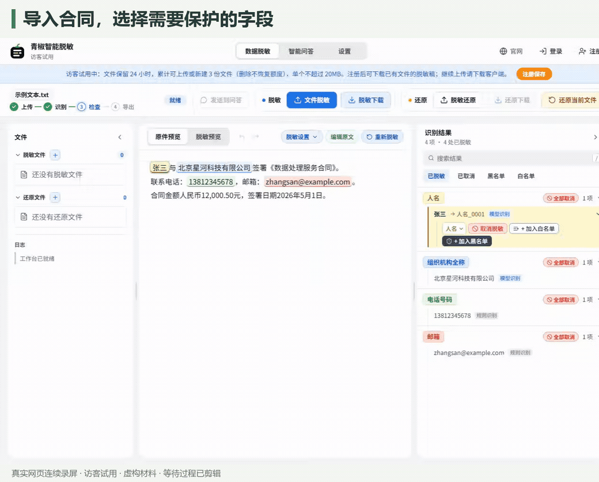
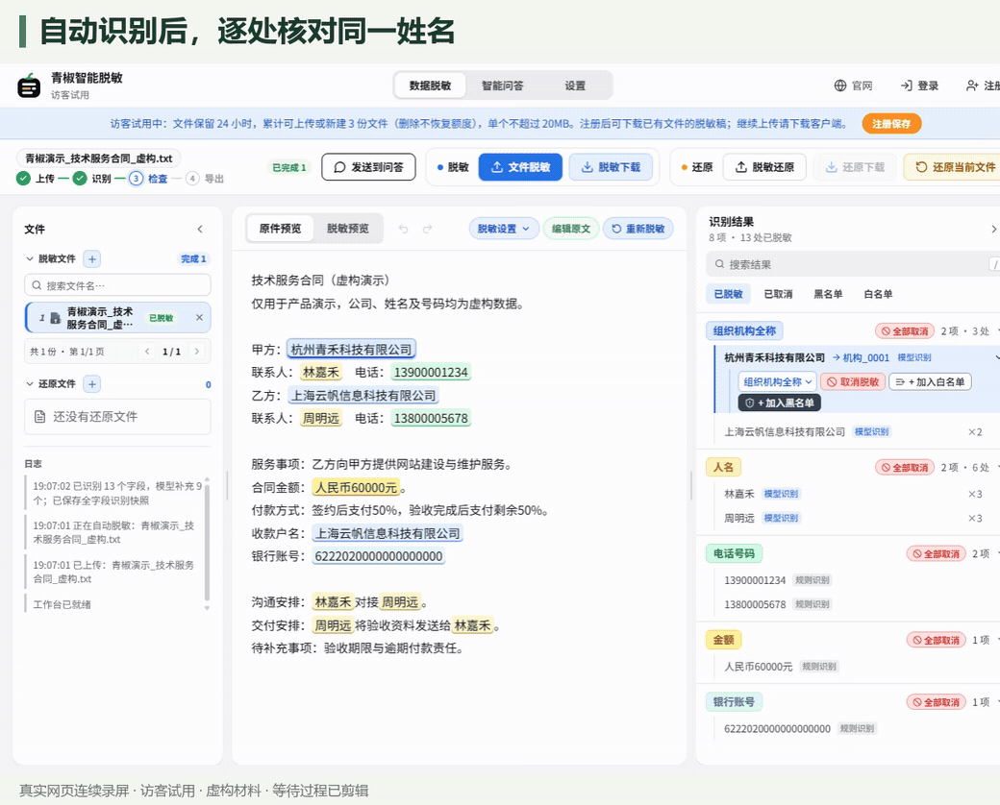
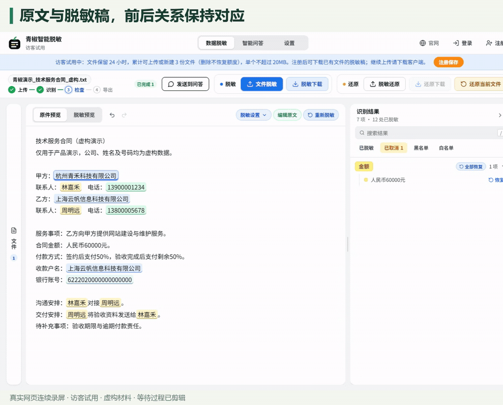
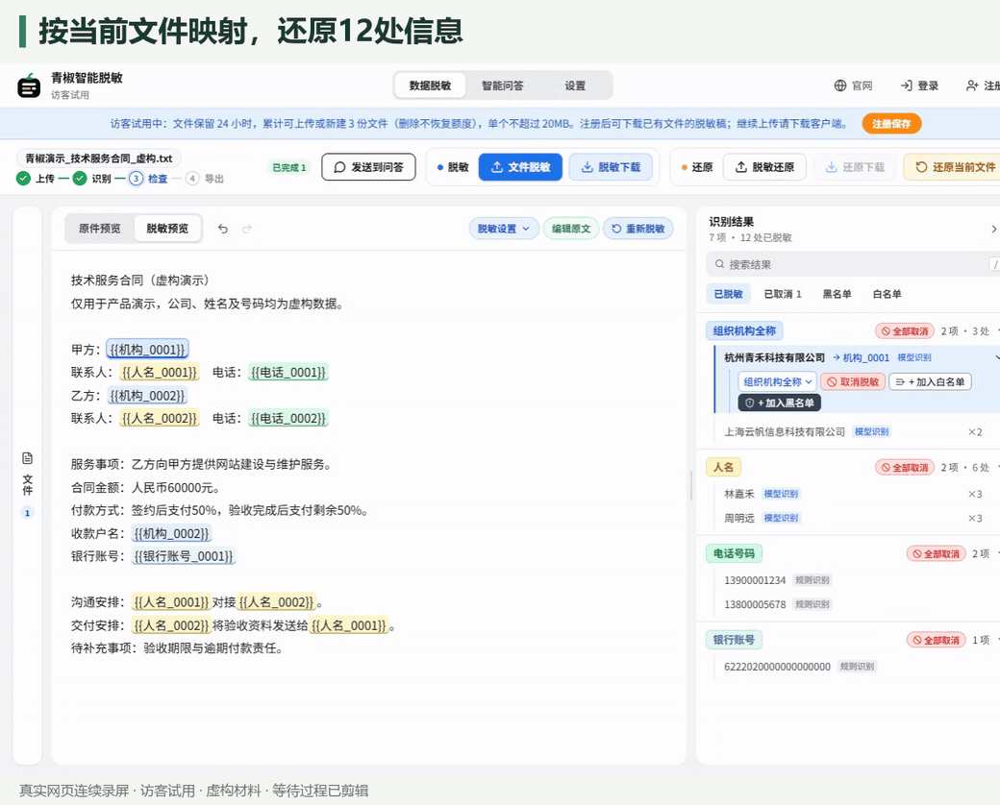
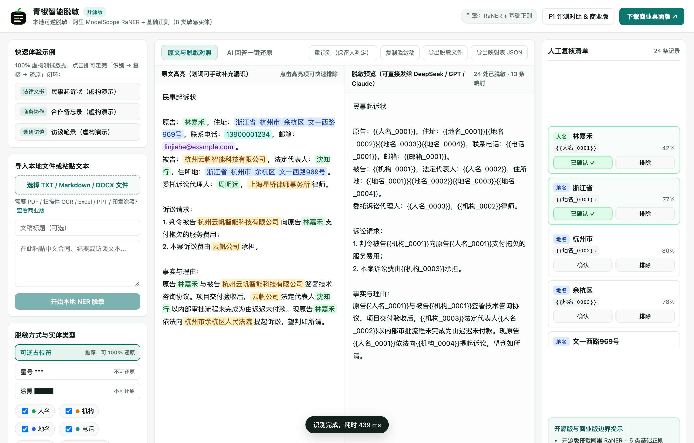
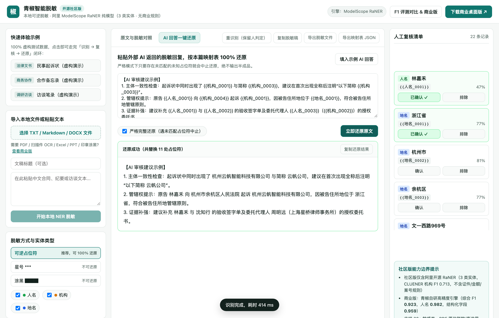

<p align="center">
  
</p>

<h1 align="center">🫑 青椒智能脱敏 · 开源社区版 (Qingjiao Redact)</h1>

<p align="center">
  <strong>无需显卡，把机密文档交给 DeepSeek / GPT / Claude 前先在本地完成可逆脱敏，AI 处理后再一键 100% 严格还原。</strong>
</p>

<p align="center">
  <a href="LICENSE"></a>
  <a href="https://www.python.org/"></a>
  <a href="https://qingjiaolab.com"></a>
  <a href="https://app.qingjiaolab.com"></a>
</p>

> **官网与桌面商业版下载**：[https://qingjiaolab.com](https://qingjiaolab.com) ｜ **商业工作台在线体验**：[https://app.qingjiaolab.com](https://app.qingjiaolab.com)

<table>
  <tr>
    <td align="center" width="50%">
      <br>
      <sub><b>1. 导入文件，按需勾选敏感字段与页面区域</b></sub>
    </td>
    <td align="center" width="50%">
      <br>
      <sub><b>2. 自动识别后逐处核对、支持黑白名单协同</b></sub>
    </td>
  </tr>
  <tr>
    <td align="center" width="50%">
      <br>
      <sub><b>3. 同一原文复用同一占位符，保证 AI 读懂上下文</b></sub>
    </td>
    <td align="center" width="50%">
      <br>
      <sub><b>4. 外部 AI 处理后，按本篇映射表严格一键还原</b></sub>
    </td>
  </tr>
</table>

---

## 为什么做「青椒智能脱敏」？

企业与专业人士受算力成本约束，难以私有化部署旗舰大模型；但把合同、裁判文书、财务表格、访谈记录直接发给云端 AI（DeepSeek / GPT / Claude）又存在敏感信息泄露风险，而传统“打黑块 / 全变星号”会导致语义断裂、AI 无法理解上下文。

**青椒智能脱敏** 在本机用极低算力打通「**本地识别 → 人工复核 → 可逆占位符脱敏 → 外部 AI 处理 → 严格映射还原**」完整闭环：

```text
原始中文文档 ──▶ 本地识别 & 人工复核 ──▶ 可逆占位符脱敏稿 ({{人名_0001}} / {{机构_0001}})
                                                     │
                                                     ▼ 放心发给任意云端 AI / Agent / MCP
还原后的真实稿件 ◀── 本地严格完整还原（映射表） ◀── AI 润色 / 合同审阅 / 问答结果
```

---

## 商业版完整能力介绍（与社区版定位区分）

- **开源社区版（本仓库）**：默认接入阿里 ModelScope 开源中文 NER 模型 `iic/nlp_raner_named-entity-recognition_chinese-base-news` + **基础正则规则**，支持 **8 类常见实体**（模型识别：`人名` / `机构` / `地名`；基础正则：`电话` / `邮箱` / `身份证号（含校验位）` / `银行卡号（含 Luhn 校验）` / `IPv4 地址`），提供三栏复核工作台、严格完整还原、CLI 与本地 `stdio` MCP Server，适合开发者学习、二次开发与轻量文本 / DOCX 场景。
- **青椒商业专业版（桌面端 & 在线工作台，[qingjiaolab.com](https://qingjiaolab.com)）**：
  1. **30+ 类敏感字段 + 4 类图像敏感区**：覆盖电话、邮箱、身份证号、银行账号、统一社会信用代码、律师执业证编号、案号、证券代码、金额、人名、机构全称/简称、项目名称、职位、文件名、法律法规、政策文件、地址、日期等，以及印章/签章、手写签名、二维码/条码、Logo 图形自动识别。
  2. **全格式原版保真处理**：支持 Word、Excel、PowerPoint、PDF、扫描件与图片；Word / PDF 支持**原位占位符脱敏**（保留版式，AI 处理后可还原回原版文件），对外发布支持 **PDF 底层文字彻底清除真涂黑**（非表面遮罩）与印章自动涂黑。
  3. **扫描件 OCR 与本地隐私问答**：内置本地 OCR 与可选云端 OCR 适配，并支持在脱敏后直接对接外部 AI 问答或将 AI 改稿一键本地还原（还原步骤完全在本地依托映射表执行，不调用外部 AI）。
  4. **零配置桌面客户端 & 批量工作流**：提供 Windows / macOS / Linux 一键安装包（无需配置 Python / Node 环境），支持多文档并发处理、文件夹批量脱敏与全局词库黑白名单。

### 对接外部 AI 问答与本地还原示例

```text
[1] 原文（留在本地）：
    甲方杭州青禾科技有限公司（联系人林嘉禾，电话 13900001234）与乙方上海云帆信息科技有限公司签署技术服务合同……

[2] 脱敏后发给外部 AI（DeepSeek / GPT / Claude）：
    甲方 {{机构_0001}}（联系人 {{人名_0001}}，电话 {{电话_0001}}）与乙方 {{机构_0002}} 签署技术服务合同……

[3] 外部 AI 返回审查建议（仅含占位符）：
    “建议 {{机构_0001}} 与 {{机构_0002}} 补充验收节点，并向 {{人名_0001}}（{{电话_0001}}）确认付款账户。”

[4] 本地按映射表一键严格还原（不联网、不调 AI；若有任一未知占位符则中止）：
    “建议 杭州青禾科技有限公司 与 上海云帆信息科技有限公司 补充验收节点，并向 林嘉禾（13900001234）确认付款账户。”
```

---

## 实测准确率对比：开源社区版 vs 商业专业版

以下数据均来自公开第三方评测集（CLUENER2020 dev）与真实业务多文体金标集（上市公司公告、合同、判决书、访谈、简历）实测，详细口径与复现脚本见 [`benchmarks/README.md`](benchmarks/README.md)：

| 对比维度 | 开源社区版（本仓库） | 青椒商业专业版（[qingjiaolab.com](https://qingjiaolab.com)） |
| :--- | :--- | :--- |
| **识别引擎** | 阿里开源 ModelScope RaNER `base-news` + **5 类基础正则** | **青椒自研高精度本地识别引擎** + 全套商业结构化校验规则 |
| **实体覆盖范围** | **8 类**（人名 / 机构 / 地名 + 电话 / 邮箱 / 身份证 / 银行卡 / IP） | **30+ 类敏感字段**（额外覆盖案号、统一社会信用代码、律师执业证、金额、证券代码、政策文件、法规、职位等）+ **4 类图像敏感区**（印章/签名/二维码/Logo） |
| **名称实体 F1（实测）** | CLUENER2020 dev：<br>人名 F1 **`0.79`**（精确率 0.72 / 召回 0.88）<br>机构 F1 **`0.71`**（精确率 0.74 / 召回 0.69，覆盖召回 0.73） | 真实多文体 101 窗金标集：<br>人名 **`0.98`**｜机构 **`0.94`**（公告 **`0.95`**）<br>地址 **`0.93`**｜文件名 **`0.95`**｜复合实体内层召回 **`0.94`** |
| **结构化字段 F1** | 基础格式校验（5 类常见字段） | 30+ 类含上下文语义校验，盲测 F1 **`0.96`**（字符遮盖率 **`0.98`**） |
| **运行开销 & CPU 速度** | ~400 MB（开源权重），冻结长文 ~55.3 s（~0.8 s/块） | **轻量级本地推理**，CPU 8 线程 **0.45 秒 / 千字**（无需 GPU） |
| **支持文件格式** | `TXT` / `Markdown` / 基础 `DOCX` | **Word / Excel / PowerPoint / PDF（原位占位符 & 真涂黑）/ 扫描件 OCR / 图片** |
| **安装与生产力** | 需自配 Python/Node 或 Docker；单篇处理 | **Windows / macOS / Linux 一键安装包（免配环境）**、文件夹批量处理、词库协同 |

> **如何选择？**
> - **开发者 / 安全研究员 / 黑客松参赛**：可以直接用本社区版研究可逆脱敏架构、部署本地 MCP 隐私防火墙，或基于 `EntityRecognizer` 协议替换自定义模型。
> - **律师 / 法务 / 财务 / 投行 / HR / 企业团队**：需要处理真实合同、扫描件 PDF、Excel、印章涂黑并要求极低漏检率，建议直接下载 **[青椒智能脱敏桌面商业版](https://qingjiaolab.com)** 或前往 **[在线工作台免费体验](https://app.qingjiaolab.com)**。

---

## 开源社区版实机运行效果

社区版提供简洁的三栏本地 Web 工作台，实机接入阿里 `ModelScope RaNER` 推理：

<table>
  <tr>
    <td align="center" width="50%">
      <br>
      <sub><b>社区版：本地 RaNER 识别、原文高亮与人工复核</b></sub>
    </td>
    <td align="center" width="50%">
      <br>
      <sub><b>社区版：外部 AI 回复严格完整还原（遇未匹配占位符自动中止）</b></sub>
    </td>
  </tr>
</table>

---

## 快速开始

### 方式一：本地源码启动（推荐开发者）

环境要求：Python 3.11+、Node.js 20+（仅构建前端需要）。

```bash
git clone https://github.com/lzq-0529/qingjiao-redact.git
cd qingjiao-redact

# 1. 创建虚拟环境并安装核心依赖
python3 -m venv .venv
.venv/bin/pip install -r backend/requirements.txt

# 2. 安装阿里 ModelScope RaNER 推理依赖（首次识别自动下载约 400MB 公开权重到 .model_cache/）
# 国内网络可加清华源加速：-i https://pypi.tuna.tsinghua.edu.cn/simple
.venv/bin/pip install -r backend/requirements-ner.txt

# 3. 构建工作台前端
cd frontend && npm install && npm run build && cd ..

# 4. 一键启动（默认监听 http://127.0.0.1:8000）
./start.sh
```

> **零下载快速预览模式**：如果只想在 10 秒内体验界面交互与严格还原流程、暂不下载 400 MB RaNER 权重，可以运行：
> ```bash
> QINGJIAO_NER_ENGINE=demo ./start.sh
> ```
> 该模式仅匹配内置 3 份虚构样稿中的演示实体；处理任意中文文档请使用默认 `raner` 模式。

### 方式二：Docker Compose 一键运行

```bash
docker compose up --build
# 浏览器打开 http://127.0.0.1:8000
```

---

## 接入 Cursor / Claude Desktop（本地隐私 MCP 防火墙）

社区版内置零外部依赖的标准 JSON-RPC 2.0 `stdio` MCP Server（`backend/app/mcp_server.py`），暴露 4 个工具：
- `redact_text`：本地运行 RaNER 脱敏并返回脱敏文本 + `session_id`
- `restore_text`：按 `session_id` 严格还原 AI 回复中的占位符
- `list_sessions` / `get_capabilities`：查看本地会话与引擎状态

在 Cursor 或 Claude Desktop 的 MCP 配置中添加：

```json
{
  "mcpServers": {
    "qingjiao-redact": {
      "command": "/ABSOLUTE/PATH/TO/qingjiao-redact/.venv/bin/python",
      "args": ["-m", "app.mcp_server"],
      "env": {
        "PYTHONPATH": "/ABSOLUTE/PATH/TO/qingjiao-redact/backend",
        "QINGJIAO_NER_ENGINE": "raner",
        "MODELSCOPE_CACHE": "/ABSOLUTE/PATH/TO/qingjiao-redact/.model_cache/modelscope",
        "QINGJIAO_DATA_DIR": "/ABSOLUTE/PATH/TO/qingjiao-redact/data"
      }
    }
  }
}
```

---

## CLI 命令行用法

```bash
.venv/bin/pip install --no-deps -e .

# 1. 本地脱敏文件（生成脱敏稿 + .map.json 映射表）
qingjiao-redact redact contract.docx -o contract.redacted.docx --mode placeholder

# 2. 将 AI 改写后的文件按映射表严格还原
qingjiao-redact restore contract.ai-edited.docx -m contract.redacted.map.json -o contract.restored.docx

# 3. 启动 Web 工作台 / MCP 服务
qingjiao-redact serve --port 8000
qingjiao-redact mcp
```

---

## 目录结构

```text
qingjiao-redact/
├── backend/
│   ├── app/
│   │   ├── ner.py          # 阿里 ModelScope RaNER 引擎 + EntityRecognizer 插件协议
│   │   ├── regex_rules.py  # 基础正则引擎（电话 / 邮箱 / 身份证号 / 银行卡 / IPv4）
│   │   ├── redactor.py     # 可逆占位符替换、人判定合并、严格完整还原
│   │   ├── doc_io.py       # TXT / Markdown / DOCX 读写导出
│   │   ├── main.py         # FastAPI REST API + 静态前端托管
│   │   ├── mcp_server.py   # JSON-RPC 2.0 stdio MCP Server
│   │   ├── cli.py          # qingjiao-redact 命令行入口
│   │   └── store.py        # 本地 JSON 会话持久化
│   └── tests/              # 单元测试（redactor / doc_io / api / mcp）
├── frontend/               # React + Vite 三栏本地复核工作台
├── benchmarks/             # 评测说明与 CLUENER / 自定义 JSONL 复现脚本
├── docs/images/            # 核心工作流动图演示与社区版实机截图
├── Dockerfile
└── docker-compose.yml
```

## 运行测试

```bash
PYTHONPATH=backend .venv/bin/python -m unittest discover -s backend/tests -v
```

## License

本项目采用 [Apache License 2.0](LICENSE) 开源。
商业桌面版、自研高精度模型权重、商业规则库、OCR 及 PDF 原位脱敏引擎属于青椒实验室（[qingjiaolab.com](https://qingjiaolab.com)）闭源商业产品。
